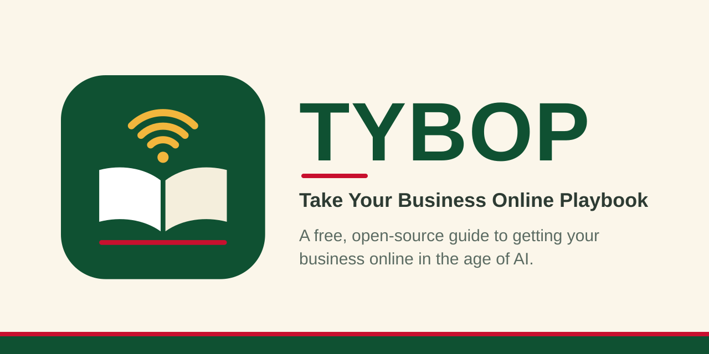

  

  
  
  
  

  <b>A free, open-source, practical guide to getting your business online and growing it in the age of AI.</b>

  <a href="docs/00-start-here.md">Start Here</a> |
  <a href="#30-day-action-plan">30-Day Plan</a> |
  <a href="templates/">Templates</a> |
  <a href="#how-to-get-involved">Contribute</a> |
  <a href="#roadmap">Roadmap</a>

---

No jargon. No gatekeeping. Step-by-step guidance for shop owners, creators, freelancers and first-time founders, written by the community, for the community.

## Who is this for?

- Small shop owners moving from offline to online
- Freelancers and creators building a brand
- Students and first-time founders with an idea
- Anyone who wants to use AI tools to work smarter, not harder

## Quick start: your first 10 minutes

1. **Read** [Start Here](docs/00-start-here.md) and pick your path (idea only, offline business, or already online).
2. **Fill in** the [Business One-Pager](templates/business-one-pager.md). It takes about 15 minutes and gives you clarity on who you sell to and why.
3. **Try one AI prompt** from the [AI Prompt Starter Pack](templates/ai-prompt-starter-pack.md) using your real business details.

That's it. Small steps beat big plans.

## What's inside

| # | Chapter | What you'll learn | Status |
|---|---------|-------------------|--------|
| 00 | [Start Here](docs/00-start-here.md) | How to use this playbook and pick your path | Written |
| 01 | [Mindset & Goals](docs/01-mindset-and-goals.md) | Define what "online" means for you | Outline |
| 02 | [Validate Your Idea](docs/02-validate-your-idea.md) | Test demand before spending money | Outline |
| 03 | [Brand & Identity](docs/03-brand-and-identity.md) | Name, logo, voice, with AI help | Outline |
| 04 | [Your Online Home](docs/04-your-online-home.md) | Domain, website, Google Business Profile | Outline |
| 05 | [Selling & Payments](docs/05-selling-and-payments.md) | Catalogs, checkout, UPI and payment links | Outline |
| 06 | [Marketing & Content](docs/06-marketing-and-content.md) | Social, WhatsApp, SEO, email | Outline |
| 07 | [The AI Toolkit](docs/07-ai-toolkit.md) | Practical AI workflows for small business | Written |
| 08 | [Operations & Legal](docs/08-operations-and-legal.md) | Registration, GST, policies, privacy | Outline |
| 09 | [Measure & Grow](docs/09-measure-and-grow.md) | Metrics that matter, next steps | Outline |

Plus ready-to-use [templates](templates/).

## 30-day action plan

Follow this in order and you'll go from zero to a live, selling business.

| Week | Goal | Do this | Chapters |
|------|------|---------|----------|
| **1** | Decide | Define your offer and test it with 5 real people | [01](docs/01-mindset-and-goals.md), [02](docs/02-validate-your-idea.md) |
| **2** | Build | Pick a name and look, get a domain, set up your Google Business Profile | [03](docs/03-brand-and-identity.md), [04](docs/04-your-online-home.md) |
| **3** | Sell | Set up a catalog and a way to get paid | [05](docs/05-selling-and-payments.md) |
| **4** | Grow | Post consistently, use AI to save time, track your first numbers | [06](docs/06-marketing-and-content.md), [07](docs/07-ai-toolkit.md) |

Legal basics and long-term growth live in [08](docs/08-operations-and-legal.md) and [09](docs/09-measure-and-grow.md). Read them once you have your first customers.

## How to get involved

This playbook gets better with every person who adds something. You don't need to be an expert. Real experience is the most valuable thing here.

| I want to... | Do this |
|--------------|---------|
| **Fix a typo or unclear sentence** | Click the pencil icon on any page, edit, and open a pull request |
| **Write a chapter** | Pick any "Outline" chapter above, fork the repo, and follow [CONTRIBUTING.md](CONTRIBUTING.md) |
| **Share a real story** | [Open an issue](https://github.com/axomiyaindie/TYBOP/issues/new) with what worked and what didn't |
| **Translate a chapter** | Add it under `docs/<language>/` (Assamese, Hindi, Bengali and more are very welcome) |
| **Suggest a topic** | [Open an issue](https://github.com/axomiyaindie/TYBOP/issues/new) and tell us who it would help |
| **Add a template** | Put it in `templates/` using the [chapter template](templates/chapter-template.md) as a guide |
| **Spread the word** | Star the repo and share it with one person who is starting a business |

### Good first contributions

- Add three free tools you actually use to any chapter's "Free / low-cost tools" section
- Add a real local example (a shop, a service, a price, a mistake)
- Review a chapter and list anything outdated or confusing
- Turn a checklist into a downloadable template

## Roadmap

- [x] Project structure and contributor guide
- [x] Chapter 00: Start Here
- [x] Chapter 07: The AI Toolkit
- [x] Logo and banner
- [ ] Chapter 04: Your Online Home
- [ ] Chapter 05: Selling and Payments
- [ ] Chapters 01, 02, 03 and 06
- [ ] Chapters 08 and 09
- [ ] More templates (pricing sheet, content calendar, customer FAQ)
- [ ] Assamese translation of Start Here
- [ ] Real case studies from small businesses
- [ ] Printable PDF edition

## Principles

1. **Free forever.** Everything here stays open.
2. **Practical first.** Every page should end with something you can *do today*.
3. **Beginner-friendly.** If a 10th grader can't follow it, rewrite it.
4. **AI as a helper, not hype.** Honest about what works and what doesn't.
5. **Local and global.** Examples from many places, languages and budgets.

## Status

**Early draft.** Chapters 00 and 07 are written, and the rest are outlines waiting for your knowledge. See [CONTRIBUTING.md](CONTRIBUTING.md) to add yours.

## Support the project

If TYBOP helps you, the best thanks is simple:

- Star the repo so more people can find it
- Share it with one person who is starting out
- Contribute one tip, one fix, or one story

## License

Released under the [MIT License](LICENSE). Use it, remix it, share it, and credit the project.
